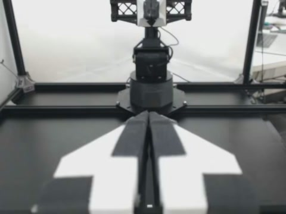

# LeRobot Boundary Audit

[](https://github.com/SimaQie/lerobot-boundary-audit/actions/workflows/tests.yml)
[](LICENSE)


Source version **0.5.0** (`main`). A CPU-only LeRobot v3 boundary audit, independent frame-identity
conformance suite, and guarded copy-based repair tool.

It finds cases where the files are readable but the data is inconsistent:

- global row indexes, episode ranges, data/video shard references, row counts;
- episode video start/end timestamps versus the declared FPS and frame counts;
- stored row timestamps versus MP4 presentation timestamps;
- single boundary frames returned by the installed official LeRobot decoder;
- full-loader windows, actions, padding masks, batches, subsets and spawned workers;
- camera payload swaps, duplicated/reordered frames and corrupted action windows
  on the bundled marker fixtures;
- narrow episode-offset/grid defects via a re-derived plan, staged repair, and
  byte-exact restoration.

It does not train models, prove physical sensor synchronization, certify whole
datasets, or claim natural upstream defects. A PASS is scoped to the selected
cameras and requested checks.

## Install

```sh
git clone https://github.com/SimaQie/lerobot-boundary-audit.git
cd -- lerobot-boundary-audit
git checkout main
python -m venv .venv
.venv/bin/python -m pip install ".[repair]"
.venv/bin/lerobot-boundary-audit --version
```

Windows: use `.venv\Scripts\python.exe` and
`.venv\Scripts\lerobot-boundary-audit.exe` with the same arguments. The examples
below use the POSIX venv paths.

Python 3.11 or 3.12 is covered by CI. Record `git rev-parse HEAD` when reporting
results from `main`. Published tags and their release assets remain versioned
snapshots; the existing `v0.4.2` release predates this source cleanup.

## Quick start (no dataset download)

```sh
.venv/bin/lerobot-boundary-audit demo --out demo-result
# open demo-result/demo-report/report.html

.venv/bin/lerobot-boundary-audit audit demo-result/merged --decode --out reports/demo-clean
.venv/bin/lerobot-boundary-audit audit demo-result/offset-one-frame --decode --out reports/demo-offset
```

The demo creates 13 clean/faulty cases. The first audit exits 0 (`pass`); the
offset case exits 1 with episode/timestamp findings. Camera swaps and duplicated
pixels intentionally pass `audit` because their timeline/index is valid; use
`conformance` or `probe-loader` for content identity.

Full walkthrough, command selection, real-data download, optional official-reader
checks and repair/restore:
[USAGE.md](USAGE.md) · [中文使用指南](USAGE.zh-CN.md).

## Commands

| Goal | Command |
|---|---|
| Audit one dataset | `.venv/bin/lerobot-boundary-audit audit DATASET --decode --out reports/x` |
| Check an official decoder at boundaries | `verify` |
| Check full loader windows/actions/padding/workers | `probe-loader` |
| Run the 13-case marker/fault matrix | `conformance` |
| Diagnose host, consumer and dataset prerequisites | `doctor` |
| Repair supported timeline defects | `repair-plan` → `apply` → `restore` |
| Create the offline example suite | `demo` |
| Download a pinned real sample | `download aloha_screw_driver` |

Exit codes: `0` requested checks passed; `1` a defect/review result; `2`
unsupported, incomplete or unable to run.

`audit` checks storage and timeline relationships. It cannot detect a camera
payload swap or duplicated frame when timestamps and indexes remain valid; use
the marker conformance suite or a real-footage `probe-loader` for content checks.

## Real data

Four pinned sources can be downloaded (selected cameras only):

```sh
.venv/bin/lerobot-boundary-audit download agibot2026 --out samples/agibot2026
.venv/bin/lerobot-boundary-audit download aloha_screw_driver --out samples/aloha_screw_driver
.venv/bin/lerobot-boundary-audit download cmu_stretch --out samples/cmu_stretch
.venv/bin/lerobot-boundary-audit download utokyo_xarm --out samples/utokyo_xarm
```

| Sample | Selected cameras | FPS | License |
|---|---|---|---|
| AgiBotWorld2026 subset | 2 / 7 | 30 | CC BY-NC-SA 4.0 |
| ALOHA screw driver | 2 / 4 | 50 | MIT |
| CMU Stretch | 1 / 1 | 5 | MIT |
| UTokyo xArm | 2 / 3 | 10 | Apache-2.0 |

The downloader pins revisions, budgets bytes, records SHA-256 hashes and refuses
mismatched files. Videos, action tables and derived datasets are not distributed
with this repository.

Most presets contain only selected cameras. Use the preset's camera names with
`audit --camera` or `probe-loader --camera`; without an explicit selection those
commands require every declared camera. The validation script selects the preset
cameras automatically. Revision, camera names and byte limits are defined in
[`download.py`](src/boundary_audit/download.py).

Full validation on a real sample:

```sh
.venv/bin/python research/validate_real_sample.py aloha_screw_driver \
  --source samples/aloha_screw_driver \
  --out reports/aloha-validation \
  --consumer-python .consumer-cpu/bin/python
```

This runs the storage/decode audit, official PyAV and TorchCodec boundary checks,
full PTS reference, authored offset control, repair, official recheck, exact
restore and index-corruption rejection.

For actual loader-returned pixel evidence, including a clean/authored-offset/repaired ALOHA example, see
[docs/real-robot-loader-pixels.md](docs/real-robot-loader-pixels.md).

## Optional official reader environment

The audit environment intentionally does not install Torch. For `verify`,
`probe-loader` and `conformance`, create a separate consumer environment:

```sh
python -m venv .consumer-cpu
.consumer-cpu/bin/python -m pip install torch==2.10.0 torchvision==0.25.0 \
  --index-url https://download.pytorch.org/whl/cpu
.consumer-cpu/bin/python -m pip install \
  "lerobot[dataset]==0.6.1" "torchcodec==0.10.0" "av==15.1.0"
```

Then pass `.consumer-cpu/bin/python` to `--python`; do not install Torch into
the audit venv. Missing packages, incompatible versions and runtime failures are
reported as `unavailable`, not hidden as PASS.

TorchCodec needs a compatible FFmpeg runtime. On Windows pass
`--ffmpeg-bin PATH_TO_SHARED_FFMPEG_BIN`; on Linux make the shared libraries
discoverable (for example via `LD_LIBRARY_PATH`).

## Diagnose before a run

`doctor` is the read-only entry point for host, optional consumer and dataset
prerequisites. It imports the official `LeRobotDataset` in the consumer process,
runs the storage audit when `--dataset` is supplied, and writes an offline
`doctor.json`/`doctor.html` when `--out` is supplied:

```sh
.venv/bin/lerobot-boundary-audit doctor \
  --dataset samples/aloha_screw_driver \
  --camera observation.images.cam_left_wrist \
  --consumer-python .consumer-cpu/bin/python \
  --out reports/doctor
```

It reports missing Torch/PyAV/FFmpeg pieces and unsupported datasets explicitly;
it does not run a loader pixel probe or claim physical synchronization. Without
`--dataset` it diagnoses only the environment.

`probe-loader` caches decoded reference frames by default in
`$LEROBOT_BOUNDARY_AUDIT_CACHE/reference` (or the platform cache directory).
The key binds the video SHA-256, requested ordinals, FPS and probe/driver
identity, so edited video or code invalidates entries. Use `--no-cache` to
disable it, `--cache-dir` to choose a location, and `--max-cache-bytes` to bound
each entry. The JSON report records hits/misses, decode seconds, cache bytes and
peak RSS. A missing or corrupt entry is a miss, and cache on/off does not change
probe conclusions.

## GPU machines

The supported path on a GPU machine is the same CPU pipeline used above. On an
RTX 4090/WSL2 host the official LeRobot 0.6.1 reader still decodes on CPU even
with CUDA Torch installed. The recorded runs cover conformance and four real-source
validation workflows, including guarded repair and restoration. Real-footage
probes may retain partial results where frame identity is ambiguous. See
[GPU machine validation](research/GPU_MACHINE_VALIDATION.md).

There is no explicit CUDA decode path in this repository and no GPU reader claim.
GPU machines do not need a different code path for the data checks.

## Scope and limits

- Tested upstream versions are LeRobot 0.6.1 (latest stable) and 0.6.0; other
  versions need their own run.
- The marker suite is synthetic H.264; real samples are AV1. Marker identity is
  not a general content detector for arbitrary footage.
- `audit` accepts one MP4 sample-tick of timestamp quantization at non-integer
  FPS or coarse timescales. This does not hide a one-frame offset; the official
  LeRobot writer declares integer FPS, so non-integer datasets are read-only
  metadata experiments unless the producer API supports them.
- No physical synchronization, training, robot-success or natural-defect claim.
- PARTIAL/ambiguous results are retained; they are not converted to PASS.
- Repair supports only narrow episode-offset/CFR tick-grid defects and always
  writes a new directory; source files are never edited.

## Development

```sh
.venv/bin/python -m pip install ".[repair,dev]"
.venv/bin/python -m pytest -q
.venv/bin/python -m ruff check src tests examples research/validate_real_sample.py research/check_release.py
```

See [CONTRIBUTING.md](CONTRIBUTING.md), [USAGE.md](USAGE.md),
[conformance protocol](research/CONFORMANCE.md), and
[validation summary](research/GPU_MACHINE_VALIDATION.md).

## Boundary frame previews (development main)

Add `--visuals` to `audit` to save up to four boundary previews (implies
`--decode`). Open `report.html` beside its generated JPEG files. These show
the expected ordinal frame, neighbours and the frame at the recorded **local PyAV** seek PTS, reconstructed by
sequential decoding, not an official-loader pixel capture. Previews do not change audit verdicts;
repeated images do not establish unique frame identity. Additional preview decoding is bounded to
50,000 frames, and incomplete previews are labelled explicitly. Generated
media retains the source dataset's license. This feature is included in v0.5.0.

```sh
.venv/bin/lerobot-boundary-audit audit samples/aloha_screw_driver \
  --camera observation.images.cam_left_wrist --visuals --out reports/aloha-frames
```

For **actual official-loader pixels**, use `probe-loader --visuals` with an
official consumer. It captures the `LeRobotDataset` returned tensor plus
independent expected/previous/next references, hashes, returned labels and
offline relative HTML; see the ALOHA clean/authored-offset/repaired example in
[official-loader pixel evidence](docs/real-robot-loader-pixels.md). This is
different from `audit --visuals`, which shows local PyAV reconstruction.

See the [real robot example](docs/real-robot-example.md) and
[next-stage agent SOP](research/NEXT_VERSION_SOP.zh-CN.md).



Real ALOHA footage from the controlled-offset example; source and scope: [example](docs/real-robot-example.md).
