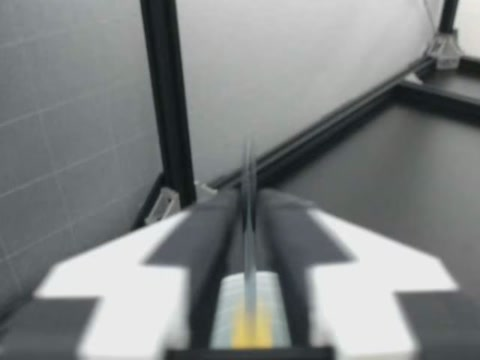

# Real robot boundary evidence: ALOHA

See [official-loader pixel evidence](real-robot-loader-pixels.md) for actual
official `LeRobotDataset`-returned pixels (clean, authored offset, repaired).

This reproducible example uses real bimanual screw-driver footage from
[lerobot/aloha_static_screw_driver](https://huggingface.co/datasets/lerobot/aloha_static_screw_driver),
revision `21eead16760a8d94d449cadf4bc438b322ab528d`.
The clean source passes the local storage/decode audit. A **local copy** has
an authored +20 ms episode-25 left-wrist start/end offset. This is a controlled
fault, not a discovered defect in the published dataset.

At the final row of episode 25 (frame 399), expected ordinal sample 10399 has
PTS 207.98 s; the shifted request returns sample 10400 at 208.00 s, across the
episode boundary. That difference is one frame at 50 FPS.

| Expected ordinal sample 10399 | Actual local PyAV return: sample 10400 |
|---|---|
|  |  |

Download/open the [offline HTML report](assets/aloha-boundary/report.html)
with its neighbouring JPEG files, or inspect the [JSON evidence](assets/aloha-boundary/report.json).
GitHub's file view does not execute the HTML. The report checks one of four
cameras, scans 20,000 rows and decodes 150 boundary queries; its preview shows
one selected query, not whole-dataset visual coverage. The original source is
not modified. The previews are sequentially decoded at the recorded local PyAV return PTS,
not captured official LeRobot loader pixels. A repeated image is not a unique frame identity guarantee.

## Reproduce on current main

Install `.[repair]` following the README, then run:

```sh
.venv/bin/lerobot-boundary-audit download aloha_screw_driver --out samples/aloha_screw_driver
.venv/bin/python examples/real_robot_report.py --source samples/aloha_screw_driver --out reports/robot-example
```

Choose a fresh output directory. The script creates a full local copy (allow
approximately 260 MB additional space), injects the stated fault, and writes
`reports/robot-example/report/report.html`. For your own dataset:

```sh
.venv/bin/lerobot-boundary-audit audit DATASET --camera CAMERA --visuals --out reports/my-frames
```

The optional previews have a 50,000-frame decode budget and show at most four
queries ranked by observed-versus-expected PTS difference. Incomplete previews
are explicitly labelled and do not change the audit verdict.

## Source and license

The dataset card declares MIT. These JPEGs are resized derivatives of its robot
footage and retain that source attribution; the dataset is not original work
of this project. Original research: [ALOHA](https://tonyzhaozh.github.io/aloha/),
Zhao et al., *Learning Fine-Grained Bimanual Manipulation with Low-Cost Hardware*.
No action tables or full source videos are bundled here. Image SHA-256 values
and the pinned dataset revision are recorded in the JSON report. Local run:
2026-10-25, PyAV 16.1.0, CPU. Cross-version official-loader media and the broader
next-version experiments are specified in the [agent SOP](../research/NEXT_VERSION_SOP.zh-CN.md).
