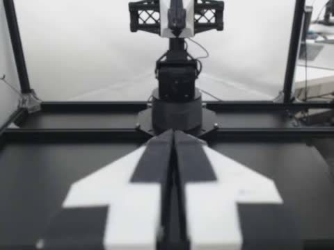

# ALOHA official-loader pixel evidence

This example captures the pixels actually returned by the installed official
`LeRobotDataset`, not frames re-decoded by the auditor. Source:
[`lerobot/aloha_static_screw_driver`](https://huggingface.co/datasets/lerobot/aloha_static_screw_driver),
revision `21eead16760a8d94d449cadf4bc438b322ab528d`, MIT. Episode 25,
left-wrist camera, query row 10000 (frame 0).

## Three controls

| Group | What happened | Probe | Loader pixels |
|---|---|---|---|
| Clean source | no edits | `partial` (other repeated-frame checks) | loader hash = expected reference |
| Authored offset copy | episode-25 video start/end +20 ms | `fail` (`wrong_frame`) | loader hash = **next** reference, not expected |
| Repaired copy | guarded plan applied and audited | `partial` (same repeated-frame checks) | loader hash = expected reference again |

The key point: `actual_returned_labels` remained
`index=10000, episode_index=25, frame_index=0` in the offset copy while the
pixels were frame 1. Row labels alone do not prove pixel identity.

### Clean: loader return matches expected

| Loader-returned (`loader_returned`) | Independent expected reference |
|---|---|
|  |  |

### Authored offset: loader return is the next frame

| Expected reference | Loader-returned |
|---|---|
|  |  |

The actual image hash equals the `next_reference` image hash
`9e898f3cd5019204…`; the expected image hash is `2156bbde499d7842…`.

### Repaired: loader return matches expected again

| Loader-returned | Expected reference |
|---|---|
|  |  |

## Offline reports and JSON

- [Clean report](assets/aloha-loader-pixels/clean-evidence/report.html) ·
  [JSON](assets/aloha-loader-pixels/clean-evidence/probe-report.json)
- [Offset report](assets/aloha-loader-pixels/authored-offset-evidence/report.html) ·
  [JSON](assets/aloha-loader-pixels/authored-offset-evidence/probe-report.json)
- [Repaired report](assets/aloha-loader-pixels/repaired-evidence/report.html) ·
  [JSON](assets/aloha-loader-pixels/repaired-evidence/probe-report.json)
- [Summary](assets/aloha-loader-pixels/summary.json) ·
  [Repair plan](assets/aloha-loader-pixels/repair-plan.json)

Each report references only relative `visuals/*.jpg` paths and opens offline.
The visual evidence records the row, episode, camera, delta, expected ordinal,
expected nominal PTS, actual returned labels, comparison result, source video
SHA-256, image SHA-256 and consumer versions. The actual loader frame has no PTS
exposed by `LeRobotDataset`; the report does not invent one from a re-decode.

## 20-second source clip

[aloha-20s.mp4](assets/aloha-loader-pixels/aloha-20s.mp4) is a 20-second H.264
derivative of the ALOHA left-wrist source (MIT, re-encoded; not a new
robot dataset). Its SHA-256 and rebuild command are in `summary.json`.

## Rebuild

```sh
.venv/bin/lerobot-boundary-audit download aloha_screw_driver --out samples/aloha_screw_driver
.venv/bin/python examples/loader_pixel_evidence.py \
  --source samples/aloha_screw_driver \
  --out reports/aloha-loader-evidence \
  --python .consumer-cpu/bin/python \
  --ffmpeg-bin PATH_TO_FFMPEG_BIN
```

The script makes a fresh copy for the controlled offset, applies the guarded
repair to another copy, and captures actual loader tensors for all three groups.
It requires approximately 1 GB free space for both derived copies, the temporary consumer view and reports. The clean
source is verified unchanged.

## Limits

These are selected query rows, not whole-dataset visual coverage. Repeated
neighbouring frames remain ambiguous/PARTIAL and are not discarded. The offset
is authored in a copy, not an upstream defect. This is not physical sensor
synchronization certification. The JPEGs and clip are ALOHA-derived media under
the dataset's MIT data-card terms, not original project footage.
